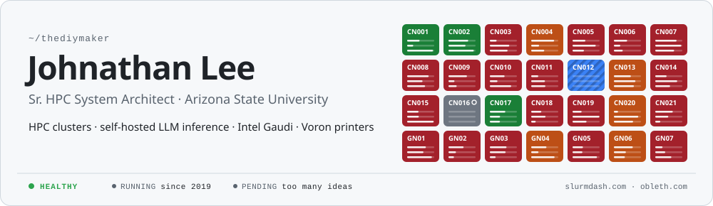
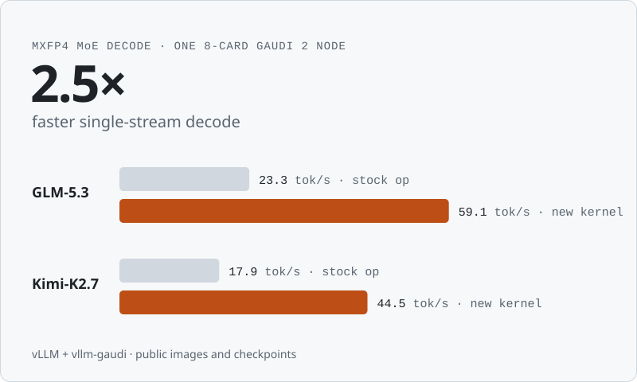
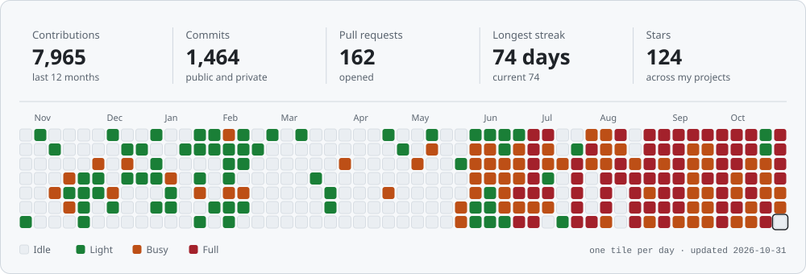

<picture>
  <source media="(prefers-color-scheme: dark)" srcset="assets/banner-dark.svg">
  
</picture>

  
  
  

HPC system architect at Arizona State University Research Computing. I work on Slurm and Kubernetes clusters and self-hosted LLM inference on Intel Gaudi, and build open tools for both. Outside of work: 3D printing, ESP32 and IoT projects, and general tinkering.

## Projects

<table>
<tr>
<td width="50%" valign="top">

<h3><a href="https://github.com/thediymaker/slurm-node-dashboard">Slurm Node Dashboard</a></h3>
Live node status for Slurm clusters: node states, CPU, memory and GPU use, job history and metrics.
Runs standalone or inside Open OnDemand.  
<a href="https://slurmdash.com"><b>slurmdash.com</b></a> ·

</td>
<td width="50%" valign="top">

<h3><a href="https://github.com/thediymaker/obleth-gateway">obleth gateway</a></h3>
An AI gateway for shared GPU clusters, written in Rust. Fairshare scheduling, model routing
and usage accounting in front of any OpenAI-compatible backend.  
<a href="https://obleth.com"><b>obleth.com</b></a> ·

</td>
</tr>
<tr>
<td width="50%" valign="top">

<h3><a href="https://github.com/thediymaker/obleth-chat">obleth-chat</a></h3>
A self-hosted chat app for obleth or any OpenAI-compatible API, with document search,
coding workspaces, and Slurm and Kubernetes tools.  
<a href="https://www.obleth.com/docs/chat/introduction"><b>Docs</b></a> ·

</td>
<td width="50%" valign="top">
<a href="https://github.com/thediymaker/gaudi-cookbook"><picture>
  <source media="(prefers-color-scheme: dark)" srcset="assets/gaudi-dark.svg">
  
</picture></a>
<h3><a href="https://github.com/thediymaker/gaudi-cookbook">Gaudi Cookbook</a></h3>
Recipes, fixes and kernels for running vLLM on Intel Gaudi 2, tested in production.  
<a href="https://thediymaker.github.io/gaudi-cookbook/"><b>Read the cookbook</b></a> ·

</td>
</tr>
<tr>
<td colspan="2" valign="top">
 

<h3 align="center"><a href="https://github.com/thediymaker/voron-knomi">KNOMI-NG</a></h3>

Custom firmware for the BTT KNOMI V2 display on Klipper printers: animated eyes, print progress,
temperatures and Box Turtle lane control. Installs from the browser.  
<a href="https://thediymaker.github.io/voron-knomi/"><b>Install from the browser</b></a> ·

</td>
</tr>
</table>

<b>More tools</b>

 

- [**slurm-history-ingestor**](https://github.com/thediymaker/slurm-history-ingestor): loads Slurm job history into PostgreSQL for reporting
- [**ood-status-iframe**](https://github.com/thediymaker/ood-status-iframe): embeds a dashboard as an Open OnDemand app
- [**autoresearch-gaudi**](https://github.com/thediymaker/autoresearch-gaudi): karpathy/autoresearch ported to Intel Gaudi 2
- [**slides-carcc2026**](https://github.com/thediymaker/slides-carcc2026): slides from my CaRCC 2026 talk on campus LLM hosting

## Cluster activity

<picture>
  <source media="(prefers-color-scheme: dark)" srcset="assets/cluster-dark.svg">
  
</picture>

## Recently shipped

<!-- releases:start -->
| Project | Release | Date |
|---|---|---|
| [obleth-chat](https://github.com/thediymaker/obleth-chat) | [`v0.9.2`](https://github.com/thediymaker/obleth-chat/releases/tag/v0.9.2) | 2026-10-28 |
| [voron-knomi](https://github.com/thediymaker/voron-knomi) | [`v0.4.0`](https://github.com/thediymaker/voron-knomi/releases/tag/v0.4.0) | 2026-10-27 |
| [slurm-history-ingestor](https://github.com/thediymaker/slurm-history-ingestor) | [`v1.1.5`](https://github.com/thediymaker/slurm-history-ingestor/releases/tag/v1.1.5) | 2026-10-26 |
| [slurm-node-dashboard](https://github.com/thediymaker/slurm-node-dashboard) | [`v3.1.0`](https://github.com/thediymaker/slurm-node-dashboard/releases/tag/v3.1.0) | 2026-10-25 |
| [obleth-gateway](https://github.com/thediymaker/obleth-gateway) | [`v2.4.0`](https://github.com/thediymaker/obleth-gateway/releases/tag/v2.4.0) | 2026-10-24 |
<!-- releases:end -->

## Tools

 

 

The banner, activity card and release list rebuild every night from <a href="scripts/build.py">scripts/build.py</a>.
